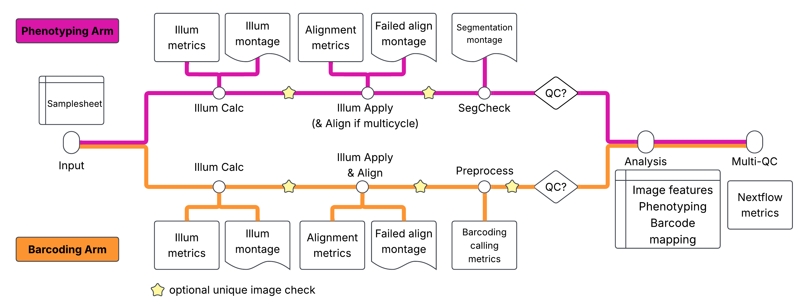

# Architecture

Technical overview of the pipeline architecture and implementation.

## Workflow Design

### Main Workflow


The main workflow (`workflows/nf-pooled-cellpainting.nf`) orchestrates the pipeline execution:

1. **Subworkflow Execution**: Runs CELLPAINTING and BARCODING subworkflows in parallel
2. **Combined Analysis**: Merges outputs from both arms (conditional on QC gates)
3. **MultiQC Report**: Generates unified QC report (conditional on QC gates)

This describes the default entrypoint. See [Alternative Entrypoints](#alternative-entrypoints) for `NO_STITCH` and `STITCH_ALIGN_CROP`.

### Cell Painting Subworkflow

Located in `subworkflows/local/cellpainting/main.nf`. The workflow is organized into three logical phases:

**Phase 1: Illumination Correction**

| Process | Description | Grouping |
|---------|-------------|----------|
| ILLUMCALC | Calculate illumination corrections per plate | `[batch, plate]` |
| QC_MONTAGEILLUM | Generate illumination QC montages | |
| ILLUMAPPLY | Apply illumination corrections per site | `[batch, plate, well, site]` |

**Phase 2: Segmentation Quality Control**

| Process | Description | Grouping |
|---------|-------------|----------|
| SEGCHECK | Segmentation quality check (subsampled by `range_skip`) | `[batch, plate, well]` |
| QC_MONTAGE_SEGCHECK | Segmentation QC visualizations | |

**Phase 3: Image Stitching (Conditional)**

| Process | Description | Grouping |
|---------|-------------|----------|
| FIJI_STITCHCROP | Stitch and crop images (enabled when `qc_painting_passed`) | `[batch, plate, well]` |
| QC_MONTAGE_STITCHCROP | Stitching QC visualizations | |

#### Barcoding Subworkflow

Located in `subworkflows/local/barcoding/main.nf`. Organized into three logical phases:

**Phase 1: Illumination Correction**

| Process | Description | Grouping |
|---------|-------------|----------|
| ILLUMCALC | Calculate cycle-specific illumination corrections | `[batch, plate, cycle]` |
| QC_MONTAGEILLUM | Illumination QC montages | |
| ILLUMAPPLY | Apply illumination corrections | `[batch, plate, well]` |

**Phase 2: Barcode Quality Control and Preprocessing**

| Process | Description | Grouping |
|---------|-------------|----------|
| QC_BARCODEALIGN | Barcode alignment QC (reports shifts/correlations against thresholds) | |
| PREPROCESS | Barcode calling and preprocessing | `[batch, plate, well, site]` |
| QC_PREPROCESS | Preprocessing QC visualizations | |

**Phase 3: Image Stitching (Conditional)**

| Process | Description | Grouping |
|---------|-------------|----------|
| FIJI_STITCHCROP | Stitch and crop images (enabled when `qc_barcoding_passed == true`) | `[batch, plate, well]` |

#### Combined Analysis (Conditional)

Located in `modules/local/cellprofiler/combinedanalysis/main.nf`. Executes when both `qc_painting_passed` and `qc_barcoding_passed` are `true`.

**Inputs**: Combines cropped images from both arms, grouped by `[batch, plate, well, site]`:

- **From Cell Painting**: Corrected images (`CorrDNA`, `CorrPhalloidin`, `CorrCHN2`, etc.)
- **From Barcoding**: Preprocessed cycle images (`Cycle##_A`, `Cycle##_C`, `Cycle##_G`, `Cycle##_T`, `Cycle##_DNA`)

**Outputs**:

- Overlay images (PNG) showing segmentation results
- CSV statistics for Nuclei, Cells, Cytoplasm, Foci measurements
- Segmentation masks (TIFF)
- Consolidated `load_data.csv` for all samples

### Alternative Entrypoints

Selected with `-entry` (defined in `main.nf`).



**`NO_STITCH`** (`workflows/no-stitch.nf`, `subworkflows/local/{cellpainting,barcoding}_no_stitch`): same as the default workflow without the `FIJI_STITCHCROP` phase; combined analysis runs on the per-site images.


**`STITCH_ALIGN_CROP`** (`workflows/stitch-align-crop.nf`): stitching, alignment and cropping happen before segmentation check and barcode preprocessing. Stitch/align/crop are not gated; only combined analysis requires both QC flags.

| Stage | Process / subworkflow | Grouping |
|-------|-----------------------|----------|
| Illumination correction | `CELLPAINTING_PRE_STITCH`, `BARCODING_PRE_STITCH` (ILLUMCALC, ILLUMAPPLY, optional duplicate check) | `[batch, plate]`, `[batch, plate, well, site]` |
| Stitch (ashlar) | `STITCH` (one task per well and cycle, per arm) | `[batch, plate, well, cycle]` |
| Align within arm | `ALIGN_INTRAARM` (cycles aligned to the first cycle; pass-through if one cycle) | `[batch, plate, well]` |
| Align across arms | `ALIGN_COMBINED` (scale, then register painting to barcoding cycle 1) | `[batch, plate, well]` |
| Crop | `CROP` (per arm) | `[batch, plate, well]` |
| QC / preprocessing | `CELLPROFILER_SEGCHECK`, `CELLPROFILER_PREPROCESS`, `QC_PREPROCESS` on cropped tiles | `[batch, plate, well]`, `[batch, plate, well, site]` |
| Combined analysis | `CELLPROFILER_COMBINEDANALYSIS` (painting images, plus optional `FociObjects.tiff`; barcoding images only if `combinedanalysis_include_barcoding_images`) | `[batch, plate, well, site]` |

The stitch/align/crop logic lives in `subworkflows/local/stitch_align_crop/main.nf`; the scripts are described in [Python Scripts](python_scripts.md).

### MultiQC Report (Conditional)

Located in `modules/nf-core/multiqc/main.nf`. Executes when both `qc_painting_passed` and `qc_barcoding_passed` are `true`.

**Aggregated Inputs**

- Software versions from all processes
- Workflow summary parameters
- Methods description

**Outputs**

- `multiqc_report.html`: Interactive HTML report
- `multiqc_data/`: Raw data and plot data
- `multiqc_plots/`: Exported plot files

Configuration is defined in `assets/multiqc_config.yml`.

## Channel Architecture

### Data Flow

Nextflow channels carry metadata and file references.

```groovy
[meta, files]
```

Where `meta` contains:

```groovy
meta = [
    batch: 'batch1',
    plate: 'P001',
    well: 'A01',
    site: 1,
    cycle: 1,          // barcoding only
    channels: ['DAPI', 'GFP', 'RFP'],
    n_frames: 4,
    arm: 'painting'
]
```

### Grouping Strategy

During the workflow execution, the input channels are grouped based on the parallelization granularity we chose for each pipeline step. The channel grouping is implemented throughout workflow and subworkflows. Below is an example of what this grouping looks like in Nextflow.

```groovy
// Group images by batch and plate for illumination calculation
// Keep metadata for each image to generate load_data.csv
ch_illumcalc_input = ch_samplesheet_cp
    .map { meta, image ->

        def group_id = "${meta.batch}_${meta.plate}"
        def group_key = meta.subMap(['batch', 'plate']) + [id: group_id]

        // Preserve full metadata for each image
        def image_meta = meta + [filename: image.name]
        [group_key, image_meta, image]
    }
    .groupTuple()
    .map { meta, images_meta_list, images_list ->
        def all_channels = images_meta_list[0].channels
        // Return tuple: (shared_meta, channels, cycles, images, per-image metadata)
        [meta, all_channels, null, images_list, images_meta_list]
    }
```

We specifically pass along the per-image metadata to the illumination correction process to efficiently generate the load_data.csv file within the process script block. These channel rewirings will look different depending on the grouping that is desired. A concrete example of two different levels of parallelization is implemented for CELLPROFILER_ILLUMAPPLY_BARCODING, which can be parallelized at the site or well level, which is controlled by a parameter (`--barcoding_illumapply_grouping`):

```groovy
// Group images for ILLUMAPPLY based on parameter setting
// Two modes:
//   - "site": Group by site - each site is processed separately
//   - "well": Group by well (default) - all sites in a well are processed together
// Site information is always preserved in image metadata for downstream preprocessing
ch_images_by_site = ch_samplesheet_sbs
    .map { meta, image ->
        // Determine grouping key based on parameter
        def group_key
        def group_id

        if (barcoding_illumapply_grouping == "site") {
            // Site-level grouping
            group_key = meta.subMap(['batch', 'plate', 'well', 'site', 'arm'])
            group_id = "${meta.batch}_${meta.plate}_${meta.well}_Site${meta.site}"
        }
        else {
            // Well-level grouping (default)
            // Site is NOT in the grouping key, but preserved in image metadata
            group_key = meta.subMap(['batch', 'plate', 'well', 'arm'])
            group_id = "${meta.batch}_${meta.plate}_${meta.well}"
        }

        // Preserve full metadata for each image (including site)
        def image_meta = meta.clone()
        image_meta.filename = image.name

        [group_key + [id: group_id], image_meta, image]
    }
    .groupTuple()
    .map { group_meta, images_meta_list, images_list ->
        // Get unique cycles and channels for this group
        // For barcoding, we expect multiple cycles
        def all_cycles = images_meta_list.collect { m -> m.cycle }.findAll { c -> c != null }.unique().sort()
        def unique_cycles = all_cycles.size() > 1 ? all_cycles : null
        def all_channels = images_meta_list[0].channels

        // Return tuple: (shared meta, channels, cycles, images, per-image metadata)
        [group_meta, all_channels, unique_cycles, images_list, images_meta_list]
    }
```

## Process Design

### Standard Process Structure

```groovy
process EXAMPLE_PROCESS {
    tag "${meta.batch}_${meta.plate}_${meta.well}"
    label 'process_medium'
    container 'wave.seqera.io/cellprofiler/cellprofiler:4.2.8'

    input:
    tuple val(meta), path(images)
    path(cppipe)

    output:
    tuple val(meta), path("output/*"), emit: images
    path("*.csv"), emit: csv

    script:
    """
    # Generate load_data.csv
    generate_load_data_csv.py \\
        --metadata-json metadata.json \\
        --images-dir ./images \\
        --output load_data.csv

    # Run CellProfiler
    cellprofiler \\
        -c -r \\
        -p ${cppipe} \\
        -o output/ \\
        --data-file=load_data.csv
    """
}
```

### Key Conventions

1. **Tagging**: Use image metadata for process identification (allows easier understanding which site / well / plate is being processed by a task)
2. **Labels**: Apply resource labels to specify resource needs (`qc`,`cellprofiler_basic`, `cellprofiler_medium`, `fiji`)
3. **Containers**: Specify container images explicitly
4. **Output channels**: Name channels with `emit:`
5. **Scripts**: Use Python helper script to generate load_data.csv for cellprofiler processes

## QC Gate Implementation

### Conditional Execution

As previously described, there are two parameters that control progression of the painting and barcoding arms: `qc_painting_passed` and `qc_barcoding_passed`. These parameters are `false` by default and can be set to `true` if the QC checks have passed or if the user is certain that the images and QC are of high quality.

```groovy
if (params.qc_painting_passed) {
    FIJI_STITCHCROP(
        CELLPROFILER_ILLUMAPPLY.out.corrected,
        ...
    )
}
```

Importantly, only setting `if else` statements to control the gating behaviour is not sufficient because Nextflow uses the dataflow paradigm and will still process all sites / wells / plates even if the QC checks fail. To prevent this, we use the [when](https://github.com/broadinstitute/nf-pooled-cellpainting/blob/025098a756da05ae1948fa94a74dd9747af90a88/modules/local/fiji/stitchcrop/main.nf#L33-L34) parameter inside the `FIJI_STITCHCROP` process to control the execution of the process. This `when` parameter will only let the process be executed if the `qc_painting_passed` or `qc_barcoding_passed` parameter respectively are set to `true`.

```groovy
process FIJI_STITCHCROP {
    when:
    params.qc_painting_passed  // or params.qc_barcoding_passed
    // ...
}
```

### Manual Review Workflow

1. Run pipeline with default QC parameters (`false`)
2. Pipeline stops after initial QC checks
3. Review QC outputs in `results/qc/`
4. Re-run with `--qc_painting_passed true` if QC passes
5. Pipeline resumes from cached results (`-resume`)

## Data Staging

### Load Data CSV Generation

All CellProfiler processes require `load_data.csv` files:

```python
generate_load_data_csv.py \
    --metadata-json metadata.json \
    --images-dir ./images \
    --output load_data.csv
```

The same script serves every CellProfiler module (`illumcalc`, `illumapply`, `segcheck`, `preprocess`, `combinedanalysis`); the calling Nextflow module builds the metadata JSON and sets the optional flags (`--has-cycles`, `--include-illum-files`, `--range-skip`). See [Python Scripts](python_scripts.md).

For more details about the `load_data.csv` file, see the [Cellprofiler Integration](cellprofiler.md) document.

## Plugin Integration

### CellProfiler Plugins

Cellprofiler plugins are downloaded and staged by Nextflow from the Cellprofiler plugin repository by default: [https://github.com/broadinstitute/nf-pooled-cellpainting/blob/025098a756da05ae1948fa94a74dd9747af90a88/nextflow.config#L83-L84](https://github.com/broadinstitute/nf-pooled-cellpainting/blob/025098a756da05ae1948fa94a74dd9747af90a88/nextflow.config#L83-L84)

## Error Handling

### Retry Strategy

Error and retry strategies are defined in the base.config file in the `/conf` directory. The pipeline supports retrying failed processes in case of insufficient memory or other defined error codes. The specific parameters and exit codes for retry behaviour can be modified via nextflow configuration:
[base.config](https://github.com/broadinstitute/nf-pooled-cellpainting/blob/dev/conf/base.config)

```groovy
process {
    errorStrategy = { task.exitStatus in ((130..145) + 104 + 175) ? 'retry' : 'finish' }
    maxRetries    = 1
    maxErrors     = '-1'
}
```

Exit codes 130-145, 104, and 175 trigger automatic retry with increased resources.
