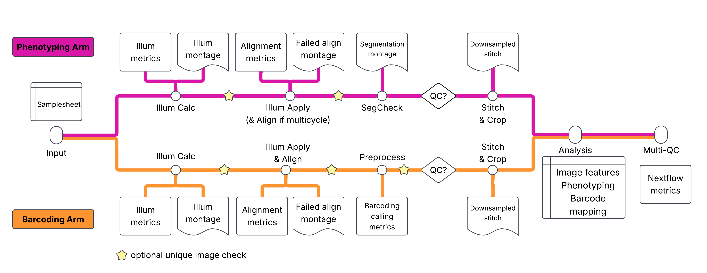
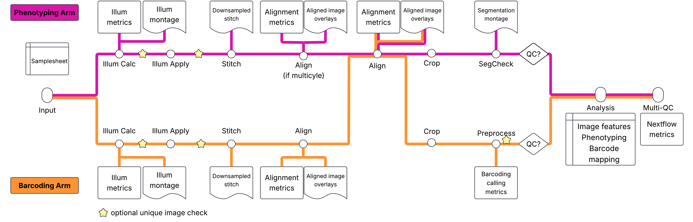

# Pipeline Overview

## Pipeline Architecture

The pipeline processes data through two parallel arms (the Cell Painting arm and the ISS arm) that operate independently on separate stacks of images before converging for final analysis in the standard workflow. The standard workflow is as follows:

### Cell Painting Arm (Phenotype)

- **Illumination Correction**: Calculates a flat-field illumination correction to correct for uneven illumination.
- **Illumination Application**: Applies the flat-field illumination correction created in the previous step.
- **Segmentation Check**: Verifies cell/nuclei segmentation quality on a subset of images
- **Stitch & Crop**: Stitches fields of view into whole-well images and crops into tiles

### Barcoding Arm (Genotype)

- **Illumination Correction**: Calculates a flat-field illumination correction to correct for uneven illumination.
- **Illumination Application**: Applies the flat-field illumination correction created in the previous step. Also performs inter-cycle alignment to align all subsequent barcoding cycles to cycle 1.
- **Preprocessing**: Compensates for spectral bleed-through, identifies barcode foci, and generates QC metrics
- **Stitch & Crop**: Stitches and crops to match Cell Painting tiles

### Combined Analysis

Once both arms pass quality control, the final **Analysis** pipeline aligns Cell Painting and barcoding images, segments cells from the phenotypic stains, measures morphological features, reads an SBS barcodes for each SBS focus and selects a best match from the barcode library, and assigns barcode foci to cells — linking each cell's genotype to its phenotype.

## Entrypoints

The pipeline has three entrypoints, selected with the `--entrypoint` parameter. These alter the sequence of image processing. The stich-align-crop workflow is as follows:

| Entrypoint | Command | What it does |
|------------|---------|--------------|
| default | `nextflow run ...` | The workflow described above: illumination correction, QC (segmentation check / preprocessing), then Fiji stitch & crop and combined analysis once the QC flags are `true`. |
| `NO_STITCH` | `--entrypoint NO_STITCH` | Same as the default but skips stitching and cropping in both arms; combined analysis runs on the per-site images. |
| `STITCH_ALIGN_CROP` | `--entrypoint STITCH_ALIGN_CROP` | Reorders processing: illumination correction -> stitch each arm (ashlar) -> align cycles within each arm -> align painting to barcoding -> crop -> segmentation check / barcode preprocessing on the cropped tiles -> combined analysis. |

In `STITCH_ALIGN_CROP`, stitch, align and crop always run (they are not gated by `qc_painting_passed` / `qc_barcoding_passed`); only combined analysis is gated, and it requires both flags to be `true`. Relevant parameters: `tileperside`, `final_tile_size`, `painting_scalingstring`, `barcoding_scalingstring`, `painting_channame`, `barcoding_channame`, `barcoding_shift_threshold`, `barcoding_corr_threshold`, and `combinedanalysis_include_barcoding_images` (default `false`: only painting images, plus the optional barcoding `FociObjects.tiff`, are given to combined analysis). Output folders and QC report numbering differ for this entrypoint; see [Outputs](outputs.md).

Set `--check_duplicate_images true` (any entrypoint) to run a pixel-duplicate check after illumination calculation/correction and preprocessing.

## The "Stop-and-Check" Workflow

Making morphological measurements in high-content imaging data is computationally expensive. To avoid wasting resources on poor-quality data, the pipeline implements a **"Stop-and-Check"** workflow controlled by two parameters:

- `--qc_painting_passed` (default: `false`)
- `--qc_barcoding_passed` (default: `false`)

**Phase 1 - Initial Processing**: The pipeline runs through the QC checkpoints for both arms (SegCheck QC for painting, Preprocess QC for barcoding), generates QC montages, and **stops before Stitch & Crop**.

**Phase 2 - Manual Review**: You review QC outputs in `results/workspace/qc_reports/`.

**Phase 3 - Production Run**: If data looks good, set `--qc_painting_passed true` and `--qc_barcoding_passed true`, then resume with `-resume`. The pipeline continues from cached results.

## Data Hierarchy

Understanding how the pipeline organizes data:

| Level | Description | Example |
|-------|-------------|---------|
| **Batch** | Collection of plates processed together. Assumed to share some amount of technical artifacts. | `Batch1` |
| **Plate** | Physical multi-well plate. Typically a smaller number of larger wells than for an arrayed experiment. | `Plate1` |
| **Well** | Single experimental unit. All cells within a well share a common pool of genetic perturbations and may share a common secondary perturbation (such as an additional drug treatment). | `A01` |
| **Site** | Field of view within a well | `1`, `2`, `3`... |
| **Cycle** | Sequencing round for barcoding. Also supports multi-round phenotype acquisition | `1`, `2`, `3`... |
