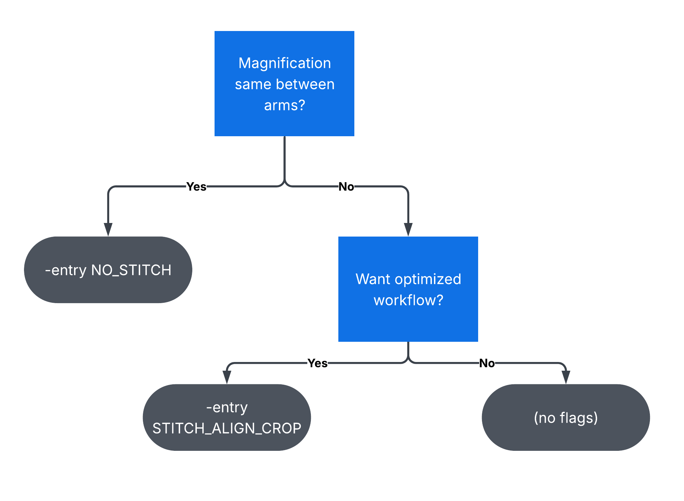
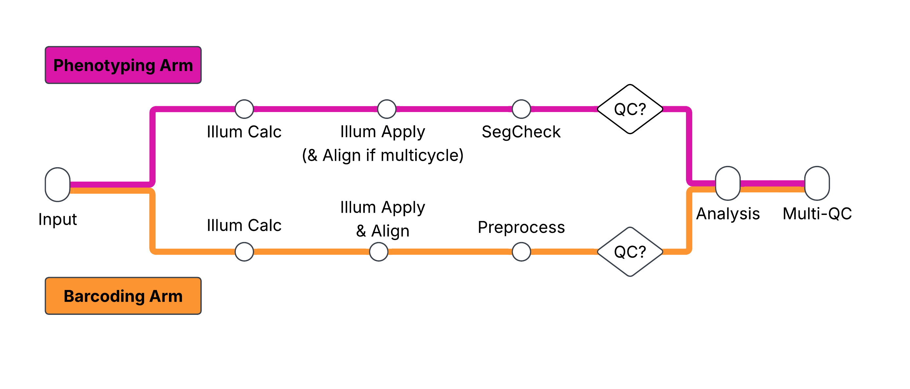
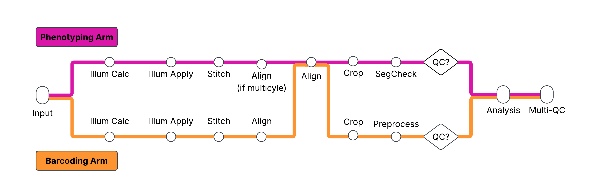
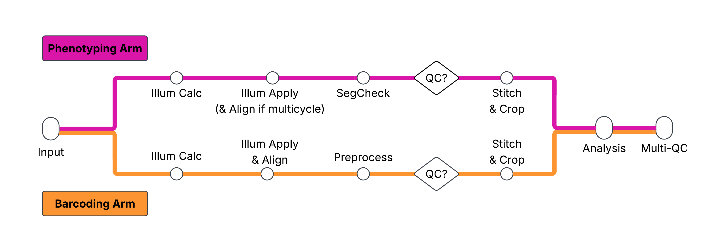
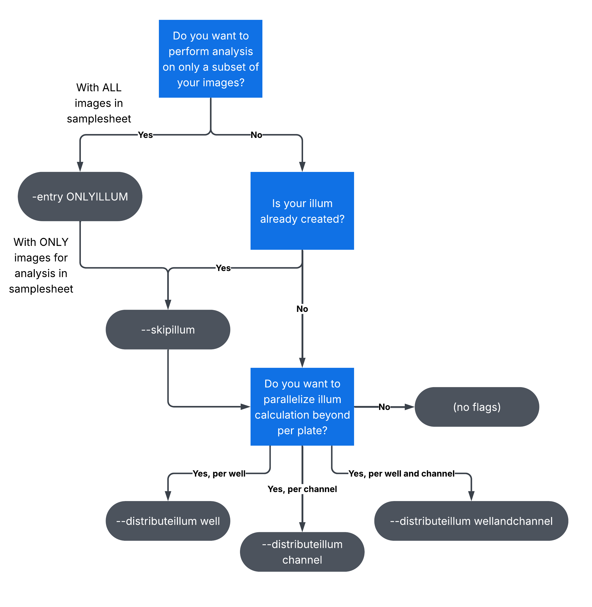
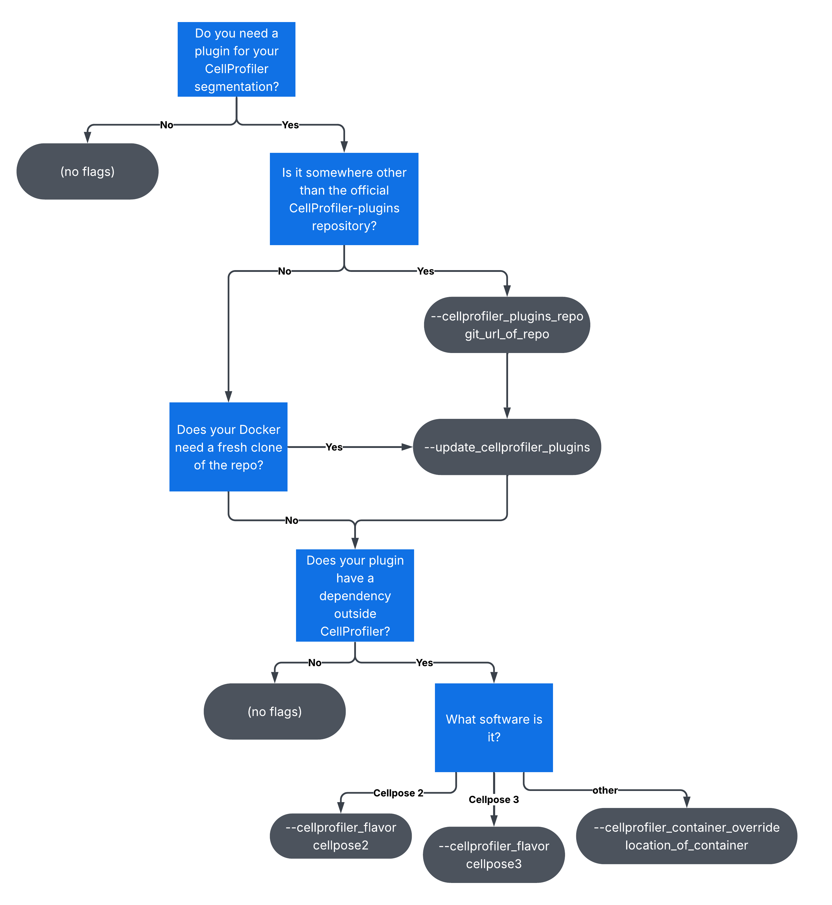

# Workflow Variations

nf-pooled-cellpainting supports many variations of the image processing workflow.
Here we describe variations, what flags you should pass to use them, and why you would want to make each workflow choice.

## Choosing entrypoint

**NO_STITCH**. If your images are the same magnification **and all phenotyping and barcoding cycles are registered/aligned within a small number of pixels** then you do not need to perform stitching and cropping and can use `NO_STITCH` which is the original workflow with stitching/cropping removed. Access the no-stitch variant by passing in `-entry NO_STITCH` in CLI or in Seqera portal under Advanced Settings => Workflow entry name => `NO_STITCH`.

**STITCH_ALIGN_CROP**. `STITCH_ALIGN_CROP` is our current suggested starting point for most datasets. Stitching, alignment and cropping happen before segmentation check and barcode preprocessing and are handled in Python. Access the stitch-align-crop variant by passing in `-entry STITCH_ALIGN_CROP` in CLI or in Seqera portal under Advanced Settings => Workflow entry name => `STITCH_ALIGN_CROP`.

**Default**. If you want to use our original workflow and/or want stitching and cropping to happen in FIJI then do not pass an entrypoint flag.

## Handling illum calculation

**ONLYILLUM**. If you want to perform image analysis on only a subset of the images on your plate but would like the improved illumination correction quality that comes from calculating the illumination correction using more images than you will be analysing use `ONLYILLUM`. You should pass in a samplesheet that has **all** of your images with this flag. Access the only-illum variant by passing in `-entry ONLYILLUM` in CLI or in Seqera portal under Advanced Settings => Workflow entry name => `ONLYILLUM`.

**skipillum**. If you created illum functions already and would like to skip their calculation again, use `skipillum`. If you are doing this after an `ONLYILLUM` run you will want to pass in a samplesheet that has **only** the images you want to analyse. You may also find this helpful if you're troubleshooting/iterating a workflow and your illum calculation isn't caching. You can pass the illum function paths in your samplesheet in an `illum_path` column or it will default to looking for where they would be output by your workflow. This works with either the default entrypoint or the `STITCH_ALIGN_CROP` entrypoint. Access the skip-illum variant by passing in `--skipillum` in CLI or in Seqera portal under Run Parameters => General pipeline parameters for both arms => `skipillum`. Cannot be combined with `distributeillum`.

**distributeillum**. If you would like to speed up illumination correction calculation beyond the default per-plate grouping you can group by well, channel, or both. Per-well results are averaged into a single mean illumination function, so the corrections may not be mathematically identical to a per-plate calculation but should be similar enough. Cannot be combined with `skipillum`. Note that if your images are multichannel then you will be increasing the number of file touches if grouping by channel because the same image file will be loaded into multiple jobs even if only a single channel is used from it. Access the distribute-illum variant by passing in `--distributeillum well`, `--distributeillum channel` or `--distributeillum wellandchannel` in CLI or in Seqera portal under Run Parameters => General pipeline parameters for both arms => `distributeillum` => `well`, `channel`, or `wellandchannel`.

## Handling plugins for segmentation

CellProfiler plugins may be used to expand the available methods for segmentation. RunCellpose is a popular choice. You will need to specify to the workflow a Docker to use for segmentation checking and analysis that includes any software dependencies of the plugin that are not a part of CellProfiler (such as Cellpose). We supply pre-built Dockers with Cellpose2 and Cellpose3. You will also need to specify the appropriate version of the plugin - this can be from your own Github repository with your custom plugin code or the official [CellProfiler-plugins repository](https://github.com/CellProfiler/CellProfiler-plugins/).
